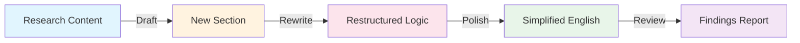

# STE-Academic-Writing

A Codex Skill that integrates academic paper writing methodology with Simplified Technical English (STE) principles for CS / AI / ML / IR papers.


## Table of Contents

- [Overview](#overview)
- [Quick Start](#quick-start)
- [Four Modes](#four-modes)
- [Installation](#installation)
- [Usage](#usage)
- [Directory Structure](#directory-structure)
- [Integration Design](#integration-design)
- [Testing](#testing)
- [License](#license)
- [Attribution](#attribution)

## Overview

Writing an academic paper involves two layers: **what to say** (structure, logic, evidence) and **how to say it** (clarity, precision, conciseness). Most tools address only one layer. This skill combines both:

1. **Academic writing structure** — section-level templates, paragraph logic, claim-evidence alignment, and reviewer-facing presentation. Adapted from [Research Paper Writing Skills](https://github.com/Master-cai/Research-Paper-Writing-Skills), which is based on Prof. Peng Sida's open study notes.

2. **Simplified Technical English** — vocabulary, verb, and sentence rules that remove ambiguity, redundancy, and AI slop. Adapted from [ASD-STE100 writing skill](https://github.com/kairin/000-0-ASD-STE100), which is an unofficial adaptation of the ASD-STE100 standard.

STE rules are applied as a **language-layer supplement**, not a primary constraint. Academic accuracy, technical rigor, and domain conventions always take priority over language simplification.

## Quick Start

```bash
# Clone and install
git clone https://github.com/zhougang2020/STE-Academic-Writing.git
cp -R STE-Academic-Writing ~/.agents/skills/
```

Then in Codex, just describe what you need:

```
Use $STE-Academic-Writing to polish my Introduction section.
```

The skill activates automatically when your task matches drafting, rewriting, polishing, or reviewing academic paper sections.

## Four Modes



| Mode | Purpose | Changes Structure? | Changes Language? |
|---|---|---|---|
| Draft | Write new sections from research content | Yes | Yes |
| Rewrite | Restructure paragraph logic and flow | Yes | Yes |
| Polish | Simplify English without changing meaning | No | Yes |
| Review | Check logic, language, terminology | No (returns findings only) | No |

### Protected Content (never modified)

| Category | Examples |
|---|---|
| Math & LaTeX | `\equation`, `\alpha`, formulas |
| Citations | `\cite{...}`, `[1]`, `(Smith et al., 2024)` |
| Technical terms | BLEU, transformer, cross-entropy loss |
| Author's claims | hypotheses, conclusions, definitions |
| Experimental data | metrics, numbers, results tables |
| Code identifiers | variable names, function names |

## Installation

Copy the skill directory into your Codex skills folder (typically `~/.agents/skills/` or `$CODEX_HOME/skills/`):

```bash
cp -R STE-Academic-Writing ~/.agents/skills/
```

## Usage

In Codex, invoke the skill by name:

```
Use $STE-Academic-Writing to polish the Introduction of my paper.
```

Or describe the task naturally — the skill activates when the task matches its description (drafting, rewriting, polishing, or reviewing academic paper sections).

### Mode-specific examples

**Draft:**
```
Use $STE-Academic-Writing in Draft mode to write an Abstract for my paper on sparse retrieval with contrastive learning. My task is document retrieval, the challenge is efficiency at scale, and my contribution is a hybrid sparse-dense encoder.
```

**Rewrite:**
```
Use $STE-Academic-Writing in Rewrite mode to restructure my Method section. The paragraphs feel disconnected.
```

**Polish:**
```
Use $STE-Academic-Writing in Polish mode to simplify the English in my Experiments section without changing any technical meaning.
```

**Review:**
```
Use $STE-Academic-Writing in Review mode to check my paper for claim-evidence alignment and terminology consistency.
```

## Directory Structure

```
STE-Academic-Writing/
├── SKILL.md                          # Main skill definition (modes, rules, output contract)
├── LICENSE                           # MIT license with derivative works notice
├── README.md                         # This file
├── test-samples.md                   # Test cases with before/after examples
└── references/
    ├── abstract.md                   # Abstract writing guide (3 templates)
    ├── introduction.md               # Introduction writing guide (Parts A-E)
    ├── related-work.md               # Related Work writing guide
    ├── method.md                     # Method writing guide (three elements)
    ├── experiments.md                # Experiments writing guide
    ├── conclusion.md                 # Conclusion writing guide
    ├── paper-review.md               # Adversarial review checklist
    ├── paragraph-flow.md             # Paragraph flow and reverse outlining
    └── examples/
        ├── index.md                  # Example bank index
        ├── abstract-template-a.md    # Challenge -> Contribution template
        ├── abstract-template-b.md    # Challenge -> Insight -> Contribution template
        └── abstract-template-c.md    # Multiple Contributions template
```

## Integration Design

### What was taken from Research Paper Writing Skills

- Section-level writing guides (Abstract, Introduction, Related Work, Method, Experiments, Conclusion)
- Paragraph clarity check and reverse outlining methodology
- Claim-evidence alignment as a hard constraint
- Adversarial self-review checklist (five dimensions)
- Abstract and Introduction templates with skeleton sentences
- Method "three elements" framework (module design, motivation, technical advantage)
- Figure and table readability rules

### What was taken from ASD-STE100

- Vocabulary substitution rules (short common words, no marketing adjectives)
- Verb rules (active voice preference, no hedge stacks, no nominalization, no phrasal verbs)
- Sentence rules (one idea per sentence, plain connectors, no semicolons)
- Noun rules (compound length limits, abbreviation discipline)
- Recurring errors reference table
- The concept of "one name for one thing" (no synonym rotation)

### What was adapted (not copied)

- STE sentence-length caps (20 words instruction / 25 words descriptive) were relaxed to a 20-25 word guideline. Technical sentences in Method or Experiments may exceed this when precision demands it.
- The STE controlled dictionary (875 approved words) was not adopted. Academic papers require domain-specific vocabulary that goes far beyond a controlled dictionary.
- STE strict mode rules (banning "however," "since," "may," "should") were relaxed. These words are standard in academic English. They are flagged in Review mode but not automatically replaced in Polish mode.
- The ste-lint.py denylist checker was not included. The skill relies on the model applying rules contextually rather than a mechanical word list.
- The senior-engineer prompt and operational aliases were not included. They are specific to the original project's engineering workflow.

### Potential conflicts resolved

1. **Passive voice**: STE bans passive in most contexts. Academic papers conventionally use passive in experimental setup ("was trained on..."). Resolution: prefer active when the actor is known, but permit passive for academic convention.

2. **Sentence length**: STE caps at 20-25 words. Academic sentences in Method sections often need more. Resolution: guideline, not hard cap.

3. **Vocabulary restriction**: STE's 875-word dictionary is too restrictive for CS/AI papers. Resolution: adopt the principle (prefer simple words) but not the dictionary.

4. **"However" and "therefore"**: STE replaces these with "but" and "thus." In academic writing, "however" and "therefore" are standard. Resolution: flag in Review mode as style suggestions, do not force replacement in Polish mode.

## Testing

See [test-samples.md](test-samples.md) for six test cases covering all four modes with real AI/IR paper paragraphs.

## License

MIT License. See [LICENSE](LICENSE) for details and derivative works notice.

## Attribution

- Academic writing methodology: Prof. Peng Sida's open study notes, adapted by Master-cai as Research Paper Writing Skills (MIT License).
- STE principles: ASD-STE100 writing skill by kairin (MIT License). ASD-STE100 is a registered EU trademark (No. 017966390) of ASD. This skill does not reproduce the standard.
